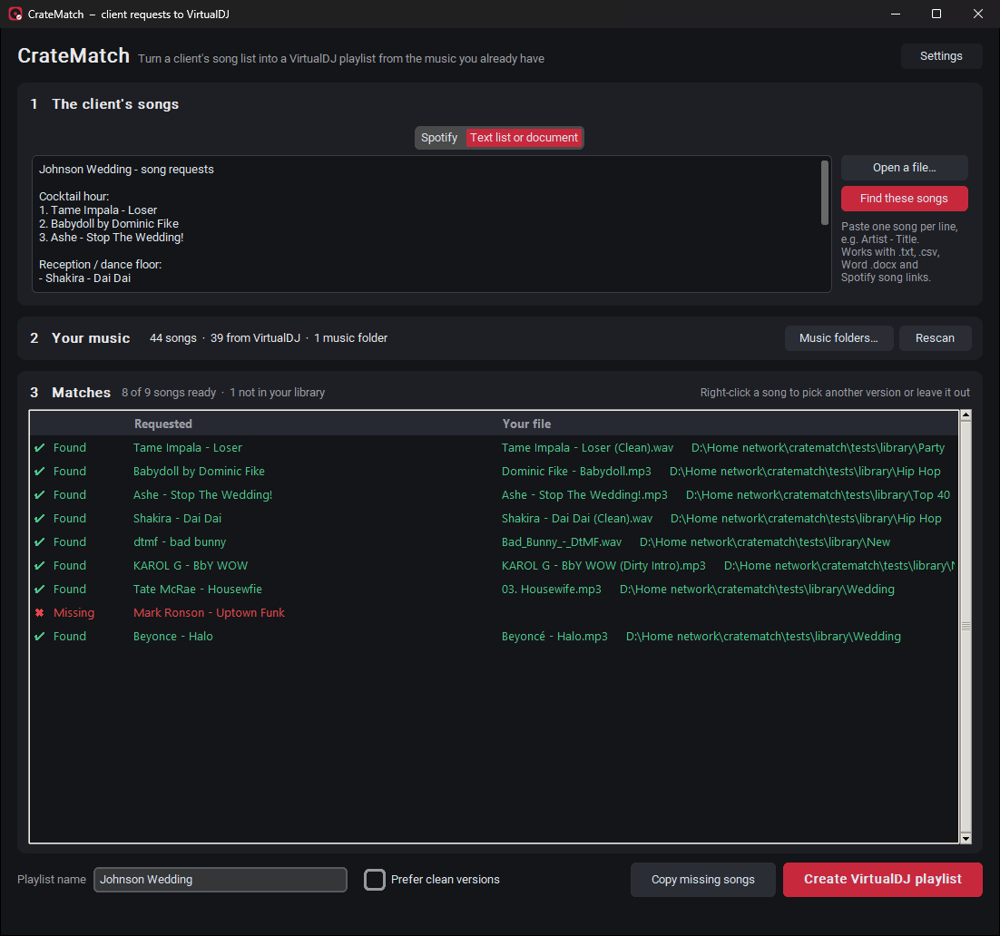
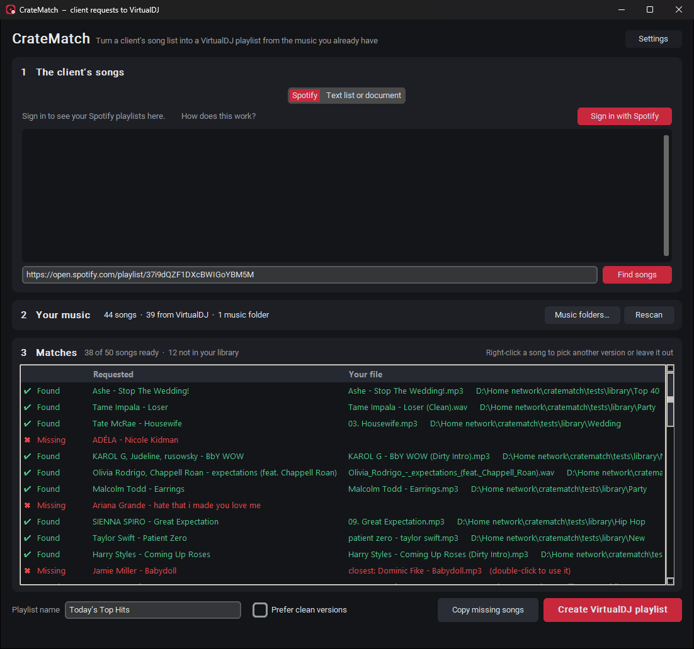
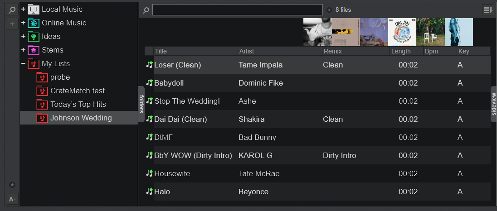

# CrateMatch

**Turn a client's song requests into a ready-to-play VirtualDJ playlist, using the music you already have.**

A client sends a Spotify playlist, a text message, a Word document or a spreadsheet of songs they want
played. CrateMatch reads that list, finds each song in your own music collection (even when your files
are named differently), and creates a playlist inside VirtualDJ under **My Lists**. Anything you don't
have is listed so you know what to get.

Nothing is downloaded, and your music files are never moved, renamed or changed.

**[⬇ Download CrateMatchSetup.exe](../../releases/latest)** (Windows 10/11)



---

## What it does

### 1. Reads the client's list, whichever way it arrives

| Source | How |
|---|---|
| **Spotify playlist link** | Paste the link and click **Find songs**. No sign-in needed (first 100 songs of a playlist). |
| **Your Spotify account** | Click **Sign in with Spotify** once; your playlists, including ones clients shared that you saved, show up to click on. Playlists you made come through in full, any length. |
| **Pasted text** | Paste straight from a text, email or note. One song per line. |
| **Files** | `.txt`, `.csv` (including Spotify exports from Exportify), Word `.docx` (paragraphs or tables), `.m3u` playlists. |
| **Copied Spotify songs** | In the Spotify app, select songs (Ctrl+A) and copy (Ctrl+C), then paste. Each song link is looked up. |

It understands how people actually write lists:

- `Artist - Title`, `Title - Artist`, `Title by Artist`, `Title (Artist)`, tab-separated columns
- numbering and bullets (`1.`, `2)`, `-`, `•`), song lengths like `3:45`, curly quotes and dashes
- **headings are skipped** ("Cocktail hour:", "Reception", "First Dance", "Johnson Wedding - song requests")
- **songs under a "Do not play" heading are left out**, and it tells you how many it skipped

### 2. Finds the songs in your music

- Searches **VirtualDJ's own library** automatically (it finds VirtualDJ's folder and reads its database
  on every drive), plus any **music folders** you add.
- Works with **MP3 and WAV** (tagged or not), and M4A, AAC, FLAC, AIFF, OGG, WMA, Opus, plus music videos.
- Reads song info from the file's tags, and from the **file name** when there are no tags, in either
  order (`Artist - Title.wav` or `title - artist.mp3`), ignoring track numbers, underscores and junk
  like "(Official Video)" or "320kbps".
- Copes with typos ("Housewfie"), missing accents ("Beyonce" → "Beyoncé"), "feat." credits, `&` vs `and`.
- Knows about versions: a request for a **remix only matches that remix**, a plain request prefers the
  original over remixes, instrumentals and live versions, and DJ edits (**clean, dirty, radio edit,
  intro, extended**) count as the same song. Tick **Prefer clean versions** for family events.
- Uses song length (from Spotify) to break ties between versions.

### 3. Shows you what it found



- **Green ✔ Found:** it's sure.
- **Yellow ? Check:** probably right, worth a glance.
- **Red ✖ Missing:** you don't have it. If something close exists, it shows "closest: …" (double-click to use it).
- **Right-click** any song to pick a different version from your library, choose a file yourself,
  leave it out, or show the file in Explorer. **Double-click** to leave a song out or put it back.
- **Copy missing songs** puts the missing ones on your clipboard so you can get them.

### 4. Creates the VirtualDJ playlist

Click **Create VirtualDJ playlist** and it appears in VirtualDJ under **My Lists**, in the client's
order, named after the playlist or file (you can rename it first).



If VirtualDJ is already open, click the little **−** next to My Lists, then **+**, to make it appear.

---

## Installing

1. Download **CrateMatchSetup.exe** from [Releases](../../releases/latest) and run it. No admin rights needed.
2. Windows may warn about an "unknown publisher" because the app isn't code-signed (a paid yearly
   certificate). Click **More info → Run anyway**. If your browser flags the download, choose **Keep**.
3. Open CrateMatch from the desktop or Start menu.

### Updates

CrateMatch updates itself. Each time it opens it checks this page's latest release. If there's a newer
version, it downloads it, installs it and reopens on its own. Settings, music folders and your Spotify
sign-in are kept. With no internet it just opens normally.

### Spotify sign-in

- Click **Sign in with Spotify**: a small Spotify window opens. Log in as usual (email, Google, Facebook
  or Apple), click **Agree**, and the window closes by itself. You stay signed in (Spotify asks again
  about every 6 months).
- CrateMatch only asks to **read your playlists**. It can't change anything in your Spotify account.
- Spotify only lets accounts the app's owner has approved use the sign-in (up to 5 people). If yours
  isn't approved yet, CrateMatch shows how to get added, and pasting playlist links still works meanwhile.
- Playlists made by someone else: Spotify only shares their first 100 songs with apps. For a longer
  one, select all its songs in the Spotify app (Ctrl+A, Ctrl+C) and paste them into the text box.

### Privacy

Everything runs on your PC. CrateMatch talks only to Spotify (to read a playlist) and GitHub (to check
for updates). Your Spotify sign-in is stored encrypted for your Windows user only.

---

## For the developer

```
python -m pip install -r requirements.txt
python run.py                        # run from source
python tests\test_match.py           # matcher checks
python tests\test_sources.py         # list parsing
python tests\make_test_library.py    # tone-file library from a real playlist, then:
python tests\test_end_to_end.py
python tools\make_screenshots.py     # README screenshots (uses tests\library)
```

- **Build Installer.bat** builds `dist\CrateMatch.exe` (PyInstaller, one file) and
  `installer\Output\CrateMatchSetup.exe` (Inno Setup, per-user install).
- **Publish Update.bat** bumps the version in `cratematch/__init__.py`, builds, commits, pushes and
  creates a GitHub release. Installed copies update the next time they open. Releases only move
  forward: to undo a bad update, publish a fixed one.
- `CrateMatch.exe --selftest <folder>` checks everything except the window and writes `selftest.log`.

### How it talks to VirtualDJ (8.5 / 2021+)

- VirtualDJ's home folder comes from `HKCU\Software\VirtualDJ\HomeFolder` (falls back to
  `Documents\VirtualDJ`). Its library is `database.xml` there, plus `X:\VirtualDJ\database.xml` on
  each drive.
- Lists shown under **My Lists** are `MyLists\<name>.vdjfolder` files
  (`<VirtualFolder><song path=… size=… songlength=… artist=… title=… idx=…/>`), and their order is the
  `MyLists\order` file. CrateMatch writes both exactly the way VirtualDJ does. `.m3u` files there aren't shown.

### Spotify app

Sign-in uses a Spotify developer app with PKCE (no client secret in the code). Its Client ID is in
`cratematch/spotify_auth.py`; redirect URI `http://127.0.0.1:43821/callback`. Development Mode rules
(Feb 2026): the app owner needs Premium, up to 5 users, and song lists are only returned for playlists
the user owns or collaborates on (others fall back to the public 100-song page).

**Adding a person:** [developer.spotify.com/dashboard](https://developer.spotify.com/dashboard) →
CrateMatch → **User Management** → their full name and the email their Spotify account uses → **Add user**.
They then click **Sign in with Spotify** again.
